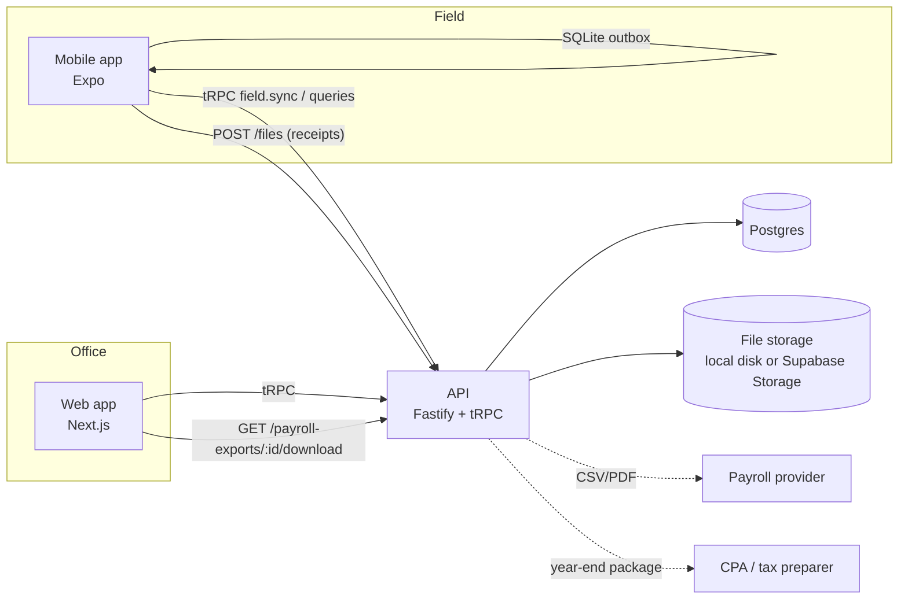

# Architecture

Timepeace is a TypeScript monorepo with three apps that share one domain package.

```
apps/
  api/      Fastify + tRPC v11 (+ a few REST routes for files and downloads)
  web/      Next.js 16 (App Router): managers, HR, owners, accountants
  mobile/   Expo SDK 58 + Expo Router: field workers (and, later, manager walkthroughs)
packages/
  db/          Prisma 7 schema, migrations, demo seed, client factory
  shared/      Domain logic with no I/O: enums, zod schemas, money/time, overtime, job cost, timer, tax map
  api-client/  Typed tRPC client + React Query bindings used by web and mobile
```



## Principles

- **The domain math lives in `packages/shared`** as pure, unit-tested functions: overtime (`overtime.ts`), pay periods, job cost and EAC (`jobCost.ts`), the clock in/out state machine and paid-time rules (`shift.ts`), and the tax category map (`tax.ts`). The API, web and mobile all import the same code, so the numbers a worker sees on their phone are the numbers HR exports.
- **Workers are paid for their shift, not their task timers.** Clock in → clock out (minus a real meal break) is paid time. It drives timesheets, overtime and gross pay. Task timers run *inside* a shift and only allocate that time to jobs for costing. Time between tasks (setup, travel, cleanup, waiting on materials) is always paid. See `finance-and-tax.md`.
- **Money is integer cents; rates are basis points.** There is no floating-point currency anywhere.
- **Instants are stored in UTC.** Calendar dates (`@db.Date`) are interpreted in the organization's IANA timezone. Workday and workweek boundaries come from `toLocalDate` / `zonedTimeToUtc`, which handle DST.
- **The server is authoritative once a timesheet is approved.** Approved, exported and paid periods are locked: edits and late field ops are rejected with a reason the device shows to the worker.

## Auth & RBAC

- Email and password, hashed with bcrypt.
- A login returns an opaque bearer token. Only its SHA-256 is stored, in `Session`. Sessions last 30 days.
- **Failed sign-in limits** (`apps/api/src/services/loginThrottle.ts`), kept in Postgres (`LoginThrottle`) because serverless instances share no memory:
  - **Per email:** 8 failures in 15 minutes locks that email for 15 minutes.
  - **Per client IP:** 40 failures in 15 minutes locks that IP.
  - A locked request gets HTTP 429 *before* the password is checked, identically for unknown emails, so lockouts don't reveal which accounts exist.
  - A correct password clears its email's count, but not the IP's, so one valid account can't be used to reset an attacker's IP count.
  - A correct password for a deactivated account isn't counted.
  - Existing-account password checks on the invite page share these limits.
  - Emails are stored as SHA-256 hashes. Untouched rows older than a day are purged opportunistically.
  - The client IP comes from Vercel's `x-vercel-forwarded-for` / `x-real-ip`, which Vercel overwrites, and only when running on Vercel. Elsewhere it's the socket address, so a header can't choose the IP.
- Mobile keeps the token in the Keychain/Keystore via `expo-secure-store`.
- Web keeps the token in `localStorage` for the MVP. *Roadmap:* move web to an httpOnly cookie session to reduce XSS exposure.
- Roles are set per organization on `Membership`:

| Role | Access |
|---|---|
| OWNER | everything |
| MANAGER | projects, tasks, budgets, scheduling, approvals, finance |
| WORKER | only projects with a task assigned to them; only their own time, expenses and pay |
| HR | payroll periods, approved timesheets, pay rates, exports; **no** project finance |
| ACCOUNTANT | read-only finance and (later) the tax center |

Guards live in tRPC middleware (`apps/api/src/trpc.ts`) and in query scoping (`services/access.ts`), so a forbidden record looks the same as one that doesn't exist (NOT_FOUND).

## Offline-first field sync

Job sites often have no signal, so every field action is written to the device before it goes to the server.

1. The mobile app turns each action into an **outbox op** with a client UUID (`opId`) and the device timestamp. The op types are `shift.clockIn`, `shift.clockOut`, `shift.breakStart`, `shift.breakEnd`, `time.start`, `time.stop`, `task.status`, `material.request` and `expense.create`; their schemas are in `packages/shared/src/schemas.ts`. Entities created offline (shifts, breaks, time entries, expenses, requests) also use client-generated UUIDs as their primary keys. Clock and timer ops are produced by `fieldReducer` (`packages/shared/src/shift.ts`), so the device and server agree on transitions.
2. Ops are appended to a SQLite `outbox` table (`apps/mobile/src/lib/db.ts`). The UI updates optimistically: timer state is persisted locally, and task status is patched in the cached "My Day".
3. `flushOutbox` (`apps/mobile/src/lib/outbox.ts`) pushes ops **in order** to `field.sync`.
   - It runs after each action, every 30 seconds, when the network returns, and when the app is foregrounded.
   - A transport error stops the flush so a stop can never overtake its start.
   - Receipt photos are uploaded first. The returned file id is written back into the op so a retry doesn't upload twice.
4. The API (`services/sync.ts`) applies each op in its own transaction and records it in `ProcessedOp`. A retry returns `duplicate` and has no effect.
   - A business-rule rejection (not assigned, period locked) is recorded and returned as `rejected`. The device keeps it and shows it to the worker.
   - An infrastructure error aborts the batch, so the device retries later in the same order.
5. Conflict rules:
   - **Shift:** starting a task while off the clock clocks the worker in first. The server also opens a shift if an older client sends `time.start` alone, so task time is never unpaid. A meal break or a clock-out stops the running task. Clocking in while an old shift is still open (a forgotten clock-out) closes the old one at its last recorded activity and flags it `AUTO_CLOSED`. A manager must confirm or correct it before the timesheet can be approved.
   - **Task timer:** a worker has one running task timer. A `time.start` closes any open entry at the same instant (switching tasks). Stopping a task keeps the worker clocked in.
   - **Task status:** last write wins by device time. Stale updates are ignored, and VERIFIED tasks can't be changed from the field.
6. **Ownership and sign-out.** Each outbox row stores the worker who made it (`user_id`), and the app only ever flushes the signed-in worker's rows, so one person's hours can never be uploaded under someone else's login on a shared phone.
   - **Signing out keeps the outbox.** Only cached screens and clock state are cleared. The rows upload the next time that worker signs in on the phone.
   - **Revoked session** (deactivated on the Team page, or the 30-day session expired): any API response of 401 while signed in makes the app sign out by itself and explain why. The flush keeps every op queued on a 401.
   - **Sign-in screen:** it lists changes still on the phone per worker, with **Share with manager**. This gives a plain-text list of clock-ins, clock-outs, tasks and expenses, so hours a deactivated worker never uploaded can still be paid.
   - Rows queued by app versions before this change (untagged) are assigned to whoever is signed in when the new version first starts. Those versions wiped the outbox on sign-out, so any surviving rows belong to that person.

## Background work

The MVP computes reports on request; the dataset is small. The plan is **pg-boss** (a Postgres-backed queue, so no Redis), used for:
- nightly report snapshots
- "timer still running" reminders
- push notifications (Expo Notifications)
- generating year-end CPA packages

## File storage

The interface is `apps/api/src/lib/storage.ts`. Development and tests store files on local disk under `.data/uploads`. Production (`STORAGE_DRIVER=supabase`) uses a private Supabase Storage bucket through its REST API with the service key, server-side only. Large downloads (the CPA package) are handed out as short-lived signed URLs. See [deployment](deployment.md).

Downloads are always authorized against org and role. Workers can only fetch their own uploads.

## Testing

| Layer | Tooling | What |
|---|---|---|
| Domain | Vitest (`packages/shared`) | Paid shift time and breaks, clock state machine, OT incl. California daily/7th-day, gross pay, job cost/EAC, cost-plus revenue, pay periods, DST, CSV escaping |
| Mobile logic | Vitest (`apps/mobile/src/lib/outbox.test.ts`) | ordered flush, offline retry, duplicates, rejections, receipt upload once |
| API | Vitest + real Postgres (`apps/api/test`) | RBAC, shift pay vs task allocation, meal vs rest breaks, auto clock-in, auto-closed shifts, sync idempotency, period locking, submit → approve → export → paid, project templates, job cost |
| End-to-end | Playwright (`apps/web/e2e`) | Manager creates a project from a template and assigns a worker; approves timesheets; HR exports CSV (OT verified) and marks it paid |
