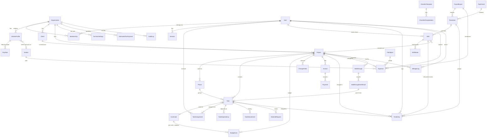

# Data model

The source of truth is `packages/db/prisma/schema.prisma`.

**Conventions:**
- Money is `Int` cents. Percentages are `Int` basis points.
- Instants are `timestamptz` in UTC. Calendar dates are `@db.Date`, interpreted in `Organization.timezone`.
- Rows created offline on mobile (`TimeEntry`, `Expense`, `MaterialRequest`) use client-generated UUIDs as primary keys.

## Key entities

| Entity | Notes |
|---|---|
| `Organization` | Timezone, entity type (drives tax line mapping), pay-period type and anchor, workweek start, overtime rules (JSON matching `OvertimeRules`), default labor burden. |
| `Membership` | User and org plus `role` and `active`. A user can belong to several orgs; the MVP signs into the first active one. Deactivating sets `active = false` and deletes that org's sessions. |
| `Invite` | Pending access for an email: role, W-2/1099 classification and optional starting pay for workers, `expiresAt` (7 days), `acceptedAt` / `revokedAt`. Stores only `tokenHash` (SHA-256), never the link. Accepting creates or links the `User`, upserts the `Membership`, and sets up the `WorkerProfile` and first `PayRate`. |
| `WorkerProfile` / `PayRate` | Classification is `W2` or `CONTRACTOR_1099`; burden can be overridden. Rates are effective-dated, and the rate in effect on the work date is used for job cost and gross pay. |
| `Project` | Contract type `FIXED` / `COST_PLUS` / `T_AND_M`, contract value, `markupBps` for cost-based billing, `projectType` for cross-project analysis, address and optional geofence. |
| `Task` | Status `TODO → IN_PROGRESS → NEEDS_MATERIALS / BLOCKED → DONE → VERIFIED`, estimate (minutes and material cents), cost code. `TaskStatusEvent` keeps the history used for "time waiting on materials". |
| `BudgetLine` | One per project × cost code × category (`LABOR`, `MATERIAL`, `SUB`, `EQUIPMENT`, `OTHER`). |
| `Shift` | **Paid time.** Clock in/out instants with GPS, the job site clocked in at (optional), source, and `flag` (`AUTO_CLOSED` when no clock-out was recorded, `EDITED` after a manager correction). An open shift (`clockOutAt = null`) means the worker is on the clock. |
| `ShiftBreak` | A recorded meal break. Deducted only if at least the org minimum (default 20 min). Shorter breaks stay paid. |
| `TimeEntry` | **Task allocation inside a shift**, for job costing only; it doesn't determine pay. Start/end instants, source `TIMER`/`MANUAL`, start/end GPS. An open entry (`endedAt = null`) is a running task timer. |
| `Timesheet` | User × pay period. Status `DRAFT → SUBMITTED → APPROVED/REJECTED → EXPORTED → PAID`. Approval freezes regular/OT/DT minutes and estimated gross (all from shifts), plus `allocatedMinutes` (how much was on tasks). |
| `Expense` | `amountCents` is the receipt total; `salesTaxCents` is the tax portion (informational, for tax prep). `paidBy = PERSONAL` means reimbursable. `taxCategory` maps to `TAX_CATEGORIES`. `paymentMethod` (card, check, ACH, cash, payment app) decides 1099 treatment. `projectId` is optional: company overhead has none. |
| `Vendor` | Subcontractor and 1099 flags, W-9 on file and received date, `taxClassification` (W-9 line 3: individual, partnership, C/S corp, LLC as C/S/P, trust, other), `isAttorney` (attorneys get 1099s even as corporations). TIN encrypted with AES-256-GCM (`apps/api/src/lib/crypto.ts`) with `tinLast4` kept for display. Only the last 4 digits are ever shown. |
| `MileageLog` | Org, driver, optional project, date, miles, business purpose, from/to. |
| `TaxYearSettings` | Per org × year: 1099 threshold, IRS mileage rate (milli-cents), effective tax rate for estimates, prior-year total tax and whether prior AGI exceeded $150k (safe harbor 110%). |
| `EstimatedTaxPayment` | Org × year × quarter, amount and date paid. |
| `ProcessedOp` | Dedupe ledger for offline ops. |
| `AuditLog` | Before/after and reason for contract value changes, budget lines, timesheet reviews, time-entry edits, expense reviews and payroll exports. |
