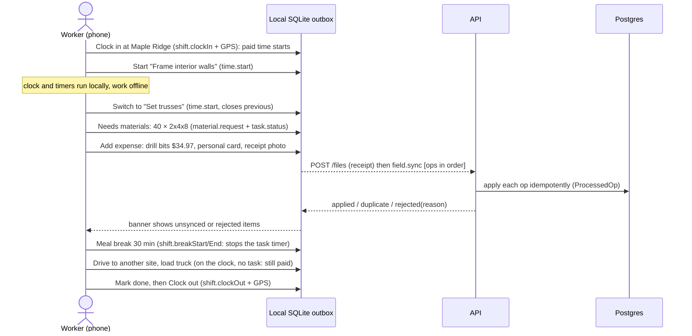

# Workflows

## 0. Company setup and joining (web)

1. **New company (admin, once):** `pnpm --filter @timepeace/db create-org -- --name … --owner-email … --owner-name … --app-url …` creates the company with standard cost codes and two project templates, and prints a single-use **owner invite link**. Nobody types or sees a password.
2. **Invite (Team page):**
   - Owners can invite any role. Managers and HR can invite field workers only.
   - For field workers, you pick W-2 or 1099. Owners and HR can also set a starting pay rate.
   - The link is shown once, with **Copy**, **Text it** (opens the phone's messages with the link filled in) and **Email it**.
3. **Accept (`/invite/<token>`):**
   - A new person confirms their name and chooses a password (10+ characters).
   - Someone who already has a Timepeace account enters that password instead.
   - Either way they're signed in. Field workers are pointed to the mobile app.
4. **Manage:**
   - **New link** replaces a lost or expired link (the old one stops working). **Revoke** cancels an invite.
   - **Deactivate** signs the person out everywhere and blocks sign-in. Their hours and history stay, and **Reactivate** restores access.
   - Owners change roles. The company always keeps at least one active owner, and nobody can deactivate or change the role of themselves.

Links expire after 7 days and work once. Only a SHA-256 hash of each link is stored. Invites, role changes, deactivations and pay-rate changes are written to the audit log.

## 1. Project setup (web, manager)

1. **Projects → New project.** Enter name, client, site address, contract type and value (or markup for cost-plus/T&M), and start date. Optionally pick a **template** such as *Single-family new build* or *Kitchen remodel*.
2. The template creates phases and tasks with cost codes and hour and material estimates.
3. On **Budget & job cost**, set budget lines per cost code and category.
4. On **Tasks & assignments**, add or adjust tasks and assign workers. An assignment is scheduled for the chosen day.

## 2. Field day (mobile, worker)



## 3. Timesheet → approval → payroll

```mermaid
sequenceDiagram
  actor W as Worker
  actor M as Manager
  actor H as HR
  participant A as API
  W->>A: field.submitTimesheet(period)
  Note right of A: refuses while the worker is still clocked in
  M->>A: approvals.timesheets: paid hours from shifts, OT, daily breakdown,<br/>each shift with breaks, task allocations, time not on a task, GPS flag
  alt a shift was AUTO_CLOSED (no clock-out)
    M->>A: editShift(real times, reason): approval is blocked until confirmed
  end
  alt looks right
    M->>A: approve → freeze reg/OT/DT minutes + estimated gross; lock the period
  else needs a fix
    M->>A: editShift / editTimeEntry(reason) (audited), or reject(note) → back to worker
  end
  H->>A: payroll.period → approved rows + reimbursable expenses
  H->>A: createExport(CSV|PDF) → timesheets EXPORTED, expenses attached
  H->>A: GET /payroll-exports/:id/download → upload to payroll provider
  H->>A: markPaid → timesheets PAID, expenses REIMBURSED
```

- **Paid hours come from clock in/out**, never from task timers alone. Time on the clock but not on a task is shown to managers as "not on a task (paid)": a job-costing signal, never a deduction.
- **Overtime** defaults to the federal FLSA rule: more than 40 hours in the workweek. Daily OT, double time and the 7th-day rule (California) are configured per organization. 1099 contractors never get OT. See `finance-and-tax.md`.
- **Locked periods:** after approval, field ops and manager edits that touch that period are rejected.

## 4. Expense review (web, manager)

- **Approvals → Expenses** lists submitted expenses: vendor, project/task, amount, and whether the worker paid personally.
- Rejecting requires a note.
- Approved personal-card expenses flow into the next payroll export as reimbursements.

## 5. Material requests (web, manager)

**Approvals → Material requests** shows what crews flagged from the field. The manager moves each request through *ordered* to *delivered*. The task's time spent in `NEEDS_MATERIALS` feeds the "crew time waiting on materials" metric.

## 6. Walkthrough checklist (planned, Phase 2; data model in place)

1. The manager opens a project on mobile and picks a template such as *Pre-drywall walkthrough*.
2. Each item gets pass, fail or N/A, with an optional photo and note.
3. A FAIL can create a punch-list `Task` linked to the item.
4. The manager finishes with a signature.
5. A PDF report goes to the client file.
